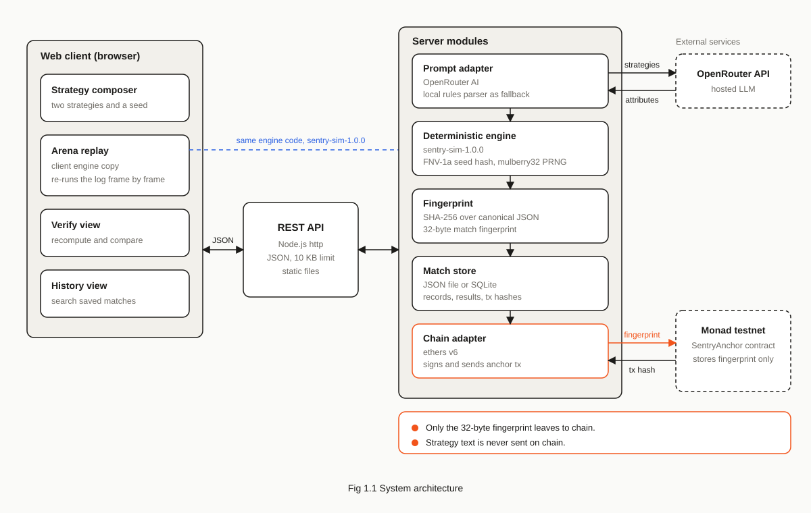

# SENTRY

**Strategy-driven AI arena with reproducible match verification.** MCA Semester I mini project, University of Mumbai (Bharati Vidyapeeth IMIT, Navi Mumbai, batch 2026–2028).

Describe two fighters in plain English. Sentry turns each description into bounded stats (aggression, speed, defence), runs a computer-controlled match from a fixed seed, and saves the result with a SHA-256 fingerprint. Anyone can replay the match, re-verify the saved result, or anchor the fingerprint on the Monad testnet.

> Academic prototype. No wagering, tokens or real money. Testnet only. The contract is unaudited.



## Run it in under five minutes

You need **Node.js 20.6 or newer** (check with `node -v`). The SQLite store additionally needs Node 22.13+.

```powershell
git clone <this repo> sentry
```

```powershell
cd sentry
```

```powershell
npm install
```

```powershell
npm start
```

Open **http://localhost:3000**. No `.env` is needed. Without one, the local rules-based parser sets the stats and anchoring shows "unavailable".

Run the tests:

```powershell
npm test
```

### Optional: AI parser via OpenRouter

1. Create a key at https://openrouter.ai/keys.
2. Copy `.env.example` to `.env` and set `OPENROUTER_API_KEY`. `OPENROUTER_MODEL` defaults to a free Llama model, and any OpenRouter model id that supports JSON output works.
3. Restart `npm start`. The header chip now reads **Parser OpenRouter**, and each fighter shows an OpenRouter source chip.

With a wrong key, or if OpenRouter is down or returns junk, matches still succeed. Each fighter then shows **Local fallback** (TC-03).

### Optional: Monad testnet anchoring

1. Make a throwaway wallet and fund it from the Monad testnet faucet. Never use a wallet that holds real funds.
2. In `.env`, set `MONAD_RPC_URL`, `ANCHOR_PRIVATE_KEY` and `EXPLORER_TX_URL`.
3. Run `npm run deploy:contract`, then copy the printed `ANCHOR_CONTRACT_ADDRESS` into `.env`.
4. Restart. **Anchor** now sends the 32-byte fingerprint to `SentryAnchor` and shows the tx hash and an explorer link.

## Two-minute demo script

1. **Run match.** Keep the default strategies and seed `arena-001`, then press **Run match**. The arena replays the fight. Stats show Fighter A as a Striker and B as a Tank.
2. **Same seed, same result.** Press **Run match** again. The new history row has the identical fingerprint.
3. **Verify.** Press **Verify**. It turns green, and the on-screen and re-run hashes match.
4. **Tamper demo.** Click *Demo: tamper with saved result*, which edits only the copy in your browser. Press **Verify** again. It turns red and shows both hashes. Restore it.
5. **Repeat 100 times.** Press **Run test**. The meter fills, and 100 browser runs plus 100 server runs come out identical (TC-02).
6. **AI down.** Switch on *AI service is down* and run a match. Both fighters show **Local fallback**, and the match still completes (TC-03).
7. **RPC down.** Switch on *Testnet RPC is down* and press **Anchor**. You get a warning that the testnet is unavailable while the match stays saved (TC-04).
8. **History.** Search for `arena-001`, or part of a fingerprint. Click a row, or press Enter on it, to reload that match.

## Project layout

| Path | What it is |
|---|---|
| `src/engine.js` | Deterministic engine `sentry-sim-1.0.0` (FNV-1a seed, mulberry32 PRNG) |
| `src/parser.js` | Validation, local parser, OpenRouter adapter, 24-point normalisation |
| `src/hash.js` | Canonical JSON and SHA-256 fingerprint |
| `src/store.js`, `src/store-sqlite.js` | JSON-file store (atomic writes) and optional `node:sqlite` store |
| `src/chain.js` | ethers v6 chain adapter with timeout and graceful "unavailable" |
| `src/server.js` | `node:http` REST API, static files, dependency injection |
| `public/` | Vanilla client (`index.html`, `styles.css`, `app.js`, `engine.client.js`, `assets/`) |
| `contracts/` | `SentryAnchor.sol`, precompiled artifact, `deploy.js` |
| `test/` | `node:test` suites for TC-01 to TC-04, plus parity and API tests |
| `docs/` | Contracts, API, architecture, testing, report notes, diagrams |

Dependencies: none at runtime. `ethers` is an optional dependency, used only for anchoring.

## Docs

- [API reference](docs/api.md)
- [Architecture](docs/architecture.md)
- [Testing and TC matrix](docs/testing.md)
- [Report notes](docs/report-notes.md) (modules, DFD walkthrough, limitations, future scope)
- [Shared contracts](docs/contracts.md)
- [Design notes](docs/design-notes.md) and [brand image prompt](docs/brand-image-prompt.md)
