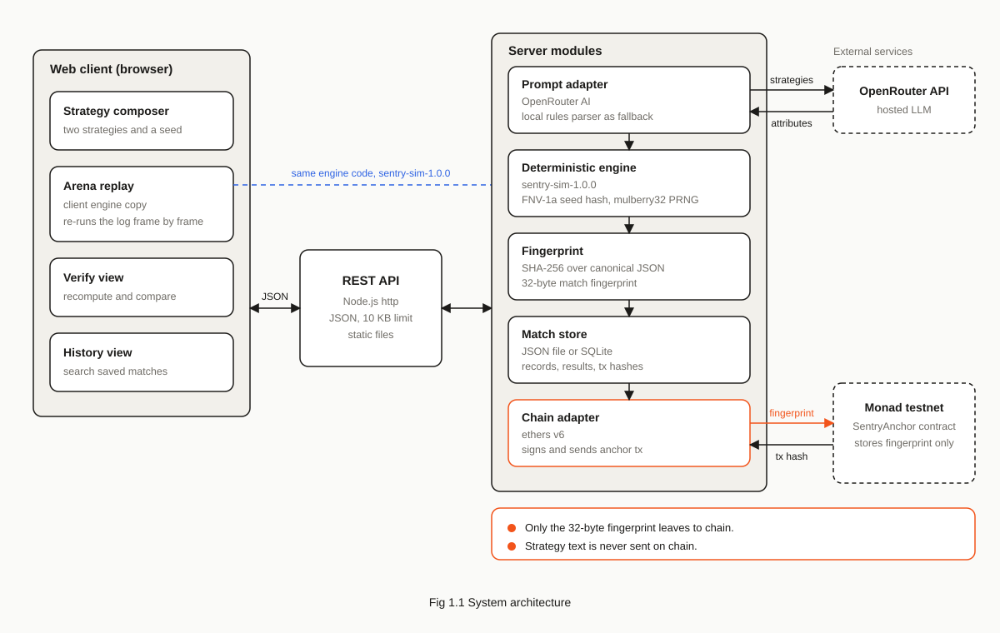
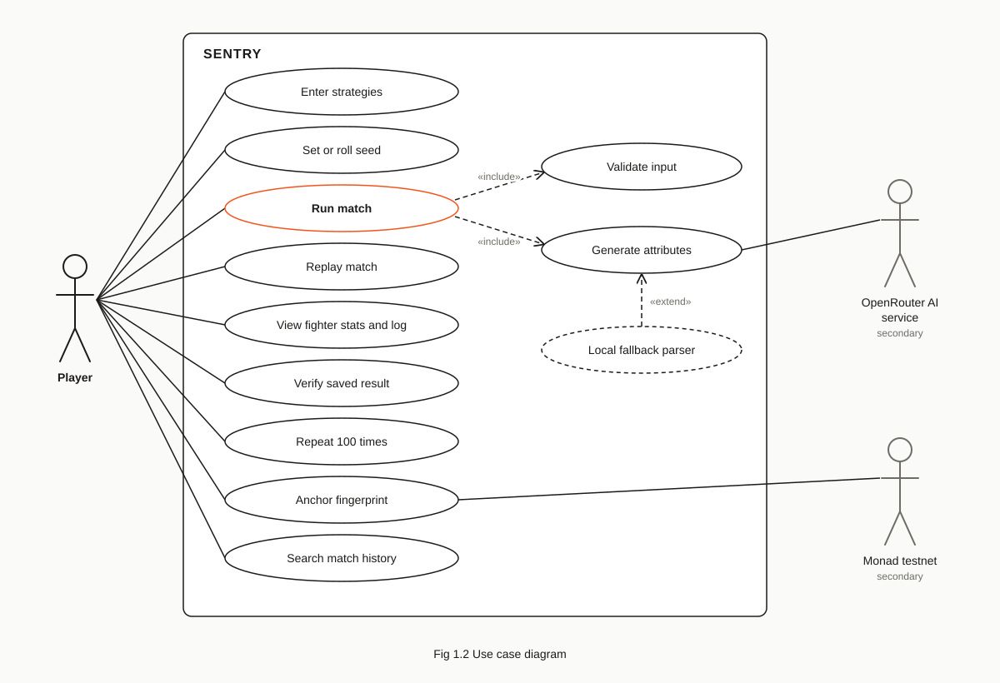
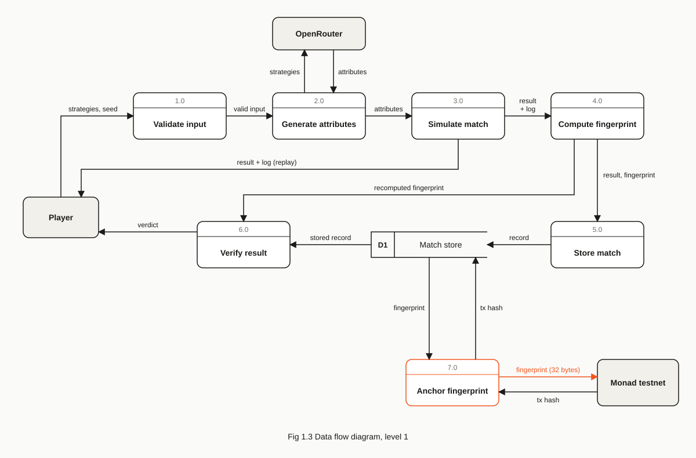

# Architecture

Sentry is a single-user web prototype with three layers.

1. **Web client** (`public/`). It is vanilla ES modules with no framework and no build step. It collects strategies, calls the REST API, and animates the returned match log. It keeps a byte-identical copy of the engine (`engine.client.js`) so replay is instant, and so the *Repeat 100 times* check can also run in the browser. The parity test keeps the two engines in lockstep.
2. **REST API** (`src/server.js`). It uses `node:http` with no framework. It validates input, orchestrates the modules and serves static files behind a path-traversal guard and a strict CSP. Every dependency (store, AI parser, chain) is injected through `createServer({ store, ai, chain })`, so tests run against an in-memory store and stubs.
3. **Modules.**
   - **Prompt adapter** (`parser.js`). It sends each strategy to OpenRouter (`temperature 0`, JSON mode, 8 s timeout), with the strategy wrapped in `<strategy>` tags and treated strictly as data. Any failure (HTTP error, timeout, non-JSON, missing or out-of-range field) falls back to the local keyword parser. Every result passes through `normalise()`: integers 1–10, total at most 24.
   - **Deterministic engine** (`engine.js`). The seed is hashed with FNV-1a to a uint32 that seeds mulberry32. The engine never touches `Math.random` or `Date`. The rules are fixed under the version string `sentry-sim-1.0.0`.
   - **Fingerprint** (`hash.js`). SHA-256 over canonical (sorted-key) JSON of `{ version, seed, attrsA, attrsB, winner, hpA, hpB, rounds }`. Prompts and the log are excluded. The log is derivable from those inputs.
   - **Match store** (`store.js`). A JSON file with atomic writes (tmp file, then rename) and a serialised write queue. `store-sqlite.js` provides the same interface on built-in `node:sqlite`. Select it with `STORE=sqlite`.
   - **Chain adapter** (`chain.js`). It uses ethers v6, loaded lazily so it stays optional. It calls `SentryAnchor.anchor(bytes32)` with only the fingerprint. A 10 s timeout and a catch-all mean it returns `{status:'unavailable', reason}` and never throws.

## Why the match is reproducible

`simulate(attrsA, attrsB, seed)` is a pure function: the same inputs always consume the same PRNG sequence, so they always produce the same log. The record stores those inputs together with the engine version. Verification re-runs the function and compares fingerprints. If someone edits the stored result, its fingerprint no longer matches. If someone changes the engine rules, `versionMatches` flags it.

## What goes on chain

Only the 32-byte fingerprint goes on chain. The contract keeps `anchoredAt[fp]` and `anchoredBy[fp]` and emits `Anchored`. It has no payable functions, no token, and no storage of strategy text.

## Use cases and data flow

See [report-notes.md](report-notes.md) for the DFD walkthrough.
